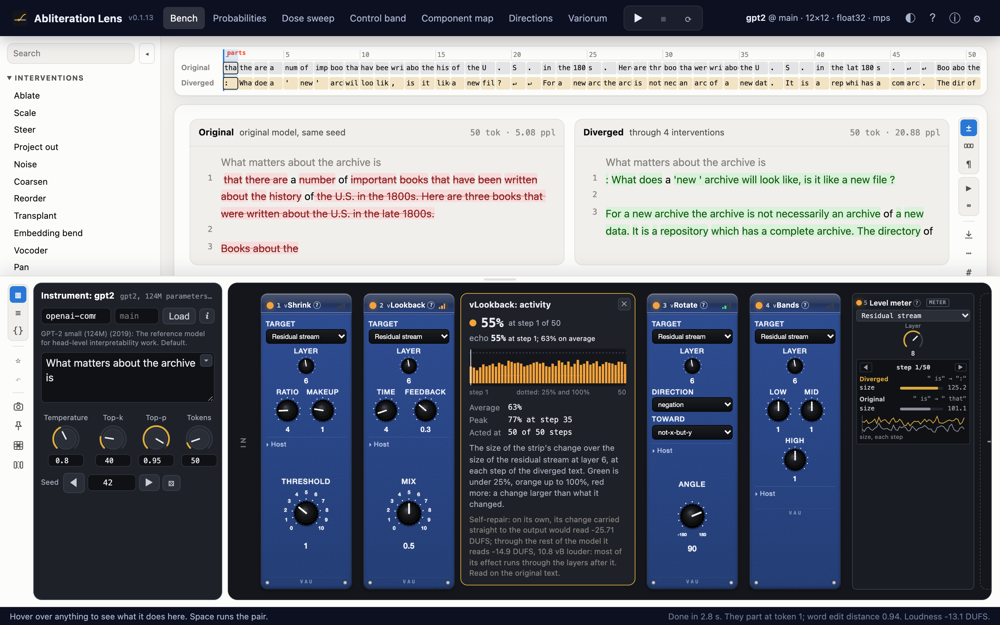
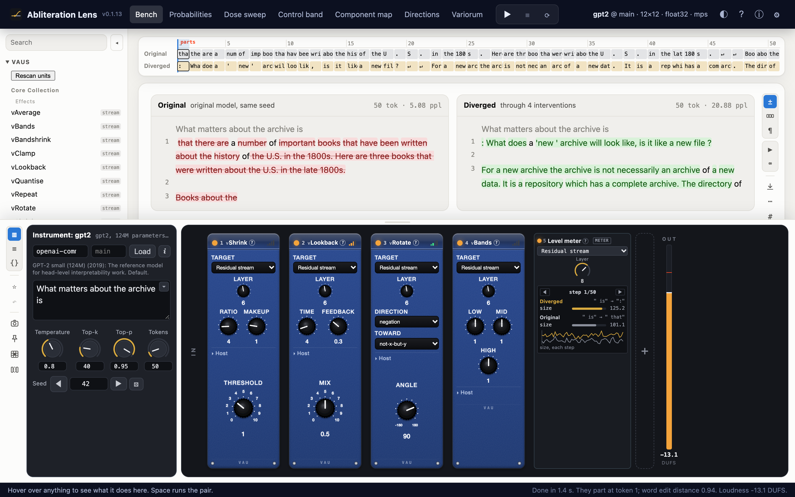
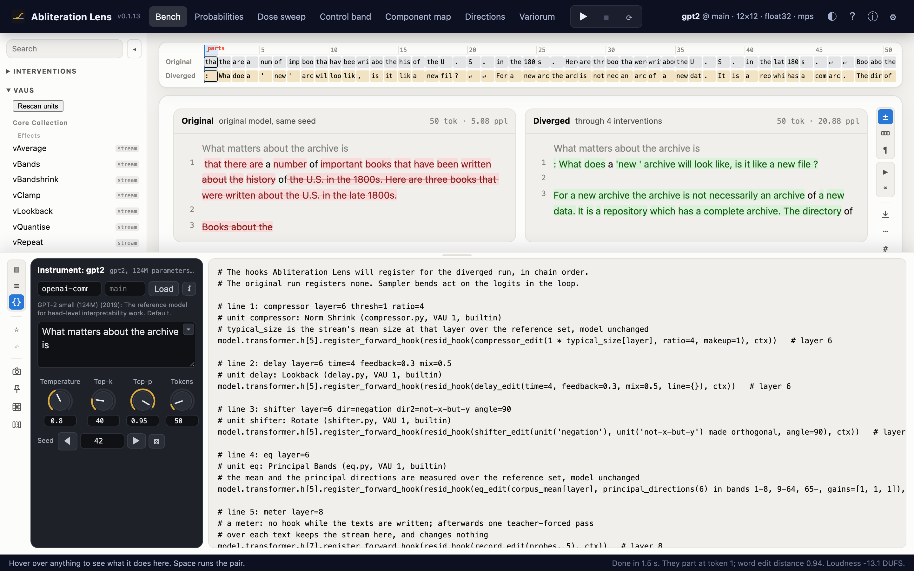
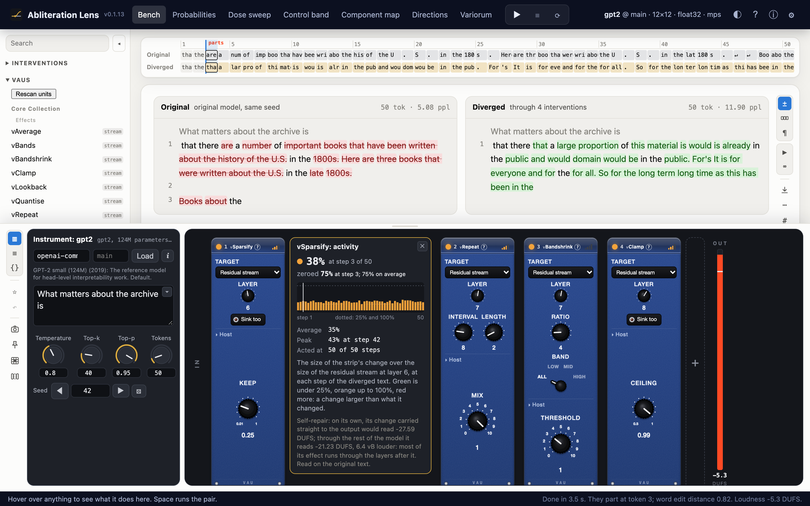
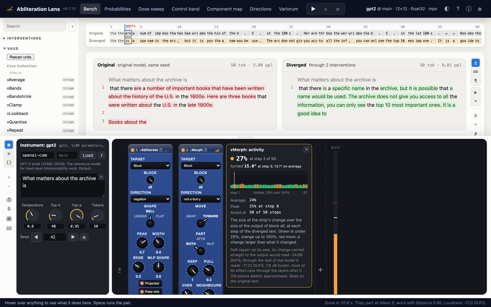
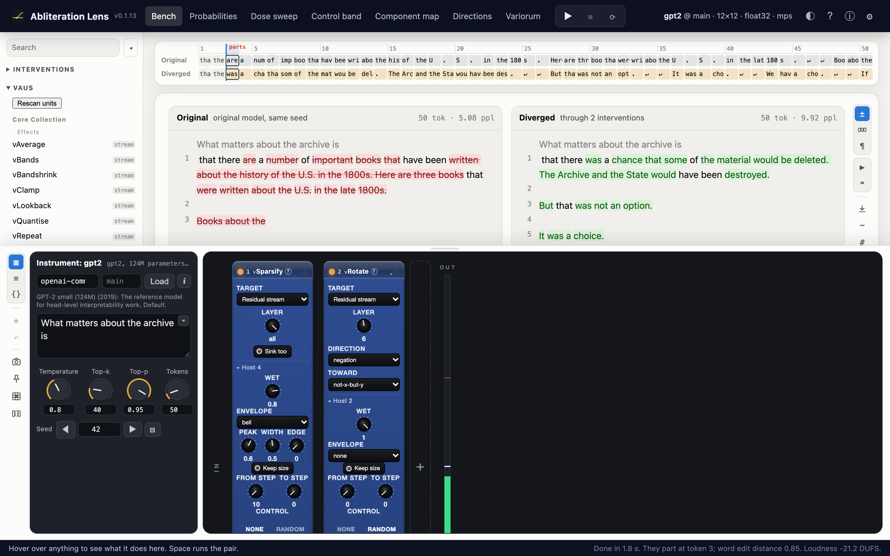
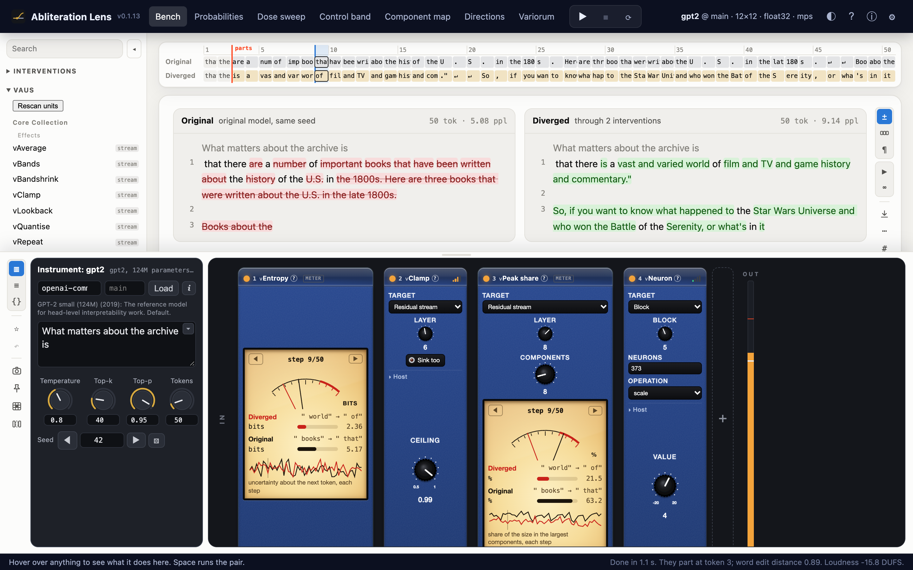
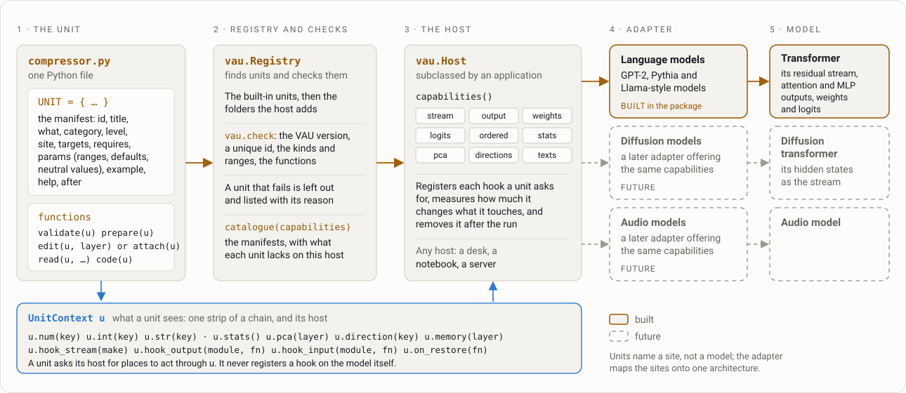
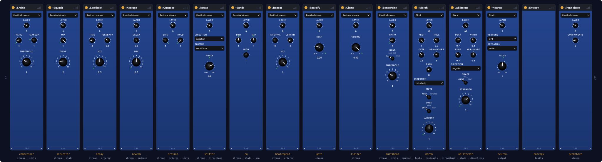
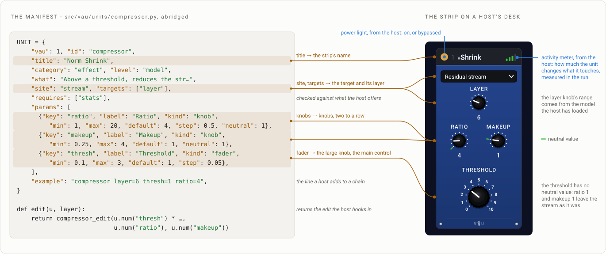

> Part of the [Vector Lab](https://github.com/vector-lab-tools). Vector methods for vector theory.
> [Overview and map](https://vector-lab-tools.github.io) · [FAQ](https://vector-lab-tools.github.io/faq.html) · [Org profile](https://github.com/vector-lab-tools)
>
> **Tier:** shared standard. **Object:** units that change what a model does from inside.
>
> **First host:** [Abliteration Lens](https://vector-lab-tools.github.io/abliteration-lens/) ([code](https://github.com/vector-lab-tools/abliteration-lens)) · **Sibling:** [Diffusion Atlas](https://github.com/vector-lab-tools/diffusionatlas)

# Vector Abliteration Units (VAU)

**A standard for units that change, or read, what a model does from inside, and the host that loads and runs them.**

**Author:** David M. Berry  
**Institution:** University of Sussex  
**Version:** 0.3.2 (VAU 1), in development  
**Licence:** GNU General Public License, version 3 or later (GPL-3.0-or-later). See `LICENSE`.  
**Site:** <https://vector-lab-tools.github.io/vector-abliteration-units/>, the standard, the built-in units and the figures (from `docs/`)

<p>
<a href="https://vector-lab-tools.github.io/abliteration-lens/"></a>
<a href="https://vector-lab-tools.github.io/abliteration-lens/"></a>
<a href="https://vector-lab-tools.github.io/abliteration-lens/"></a>
</p>

VAU units on the desk of Abliteration Lens, the first host, each drawn on its card by VAU; the browser's VAUs section, which lists them; and the Code view, the hooks they register.

<p>
<a href="https://vector-lab-tools.github.io/abliteration-lens/"></a>
<a href="https://vector-lab-tools.github.io/abliteration-lens/"></a>
<a href="https://vector-lab-tools.github.io/abliteration-lens/"></a>
<a href="https://vector-lab-tools.github.io/abliteration-lens/"></a>
</p>

Units added since: the new effects (vSparsify, vPosition Repeat, vBand Shrink, vComponent Clamp); vAbliterate and vMorph; the host features every strip has (wet, envelope, keep size, window, random control); and meter units (vEntropy, vPeak share). Each opens at full size. The [site](https://vector-lab-tools.github.io/vector-abliteration-units/) has more, with the figures below.

A Vector Abliteration Unit is one Python file. It declares what it is (a manifest: its name, its parameters, the kind of place in a model it acts on, what it needs) and supplies a few functions. A host finds units, checks them, and runs the ones a user chains together.

The split is inspired by audio plugins such as Steinberg's VST, where a plugin declares its controls and a host decides where it runs.

A unit never touches the model directly. It asks its host for a place to act (the residual stream at a layer, the output of an attention layer), and the host registers the hook, measures how much it changes what it touches, and removes it after the run. Units name a kind of place, not a model. The host's adapter maps those places onto an architecture, so the same unit can run in a language model now and in a diffusion or audio model later.

<p><a href="docs/img/architecture.svg"></a></p>

The architecture: a unit, the registry that finds and checks it, the host that runs it, and the adapter that maps its site onto one architecture. Solid boxes are built; dashed boxes are future work.

The standard is in [SPEC.md](SPEC.md), and on the [site](https://vector-lab-tools.github.io/vector-abliteration-units/spec.html).

## The Core Collection

<p><a href="docs/img/units.svg"></a></p>

The Core Collection's units as strips, at the settings of their example lines, with what each needs from a host; the green mark on a knob or fader is its neutral value. The [VAU text page](https://vector-lab-tools.github.io/vector-abliteration-units/units.html) gives each one's parameters, ranges, neutral values, help and code.

| Unit | What it does | Needs |
|---|---|---|
| vNorm Shrink | Above a threshold, reduces the stream's size at each position by a ratio | stream, stats |
| vTanh Squash | Soft-clips each dimension of the stream, harder as the drive rises | stream, stats |
| vLookback | Adds the stream from some positions back: an echo, with feedback | stream, ordered |
| vRunning Average | Adds a decaying average of the earlier positions | stream, ordered |
| vQuantise | Quantises the stream to few levels, or holds it over several positions | stream, ordered, stats |
| vRotate | Rotates the stream in the plane of two directions | stream, directions |
| vPrincipal Bands | Scales three bands of the stream's principal directions | stream, stats, pca |
| vComponent Clamp | Clamps each position's largest components at a ceiling set by a quantile of their sizes (winsorization, as Heretic and OBLITERATUS use it) | stream |
| vNeuron | Scales, adds to, sets, zeroes, flips or clamps single MLP neurons (inspired by OBLITERATUS's Neuron Lab) | output |
| vEntropy (a meter) | How uncertain the model is about the next token, in bits, step by step | logits |
| vPeak share (a meter) | The share of the stream's size held by its few largest components, step by step | stream |
| vSparsify | Keeps only each position's largest components and zeroes the rest | stream |
| vPosition Repeat | Replays the stream of the positions before over the last few of each run: a stutter | stream, ordered |
| vBand Shrink | Compresses the stream separately in three bands of its principal directions | stream, stats, pca |
| vAbliterate | Removes a direction from what attention and MLPs write, with a strength that peaks at one block and tapers (Heretic's kernel, OBLITERATUS's bell, Lai's projected and norm-preserving variants) | output, stats, directions |
| vMorph | A learned low-rank change to what attention and MLPs write, fitted to move one side of a direction's texts toward the other (inspired by Arbitrary-Rank Ablation) | output, texts, contrasts, directions |

Every strip also takes the host's features, applied around the unit's own edit: **wet** (how much of the change is applied), an **envelope** over the depth (linear, bell or flat), **keep size** (each position scaled back to its size), and a **random control** (each direction replaced by a random one of the same size, to read a direction's effect against). Each unit declares the settings at which it changes nothing, and the tests check that those settings give back the stream unchanged.

Meters are units too (SPEC section 5b): a meter reads the stream at a layer or the next-token distribution, returns one reading per step, and says how to draw them (a number per step, or ranked words).

Planned next: adapters beyond language models.

## Writing a unit

<p><a href="docs/img/anatomy.svg"></a></p>

The vNorm Shrink's manifest beside the strip a host draws from it. A host draws a knob for each `knob` or `int` parameter, the main control for the one `fader` (in the Core Collection a large knob), and a menu for a target, a direction or a choice; it adds a power light and an activity meter to every strip.

```python
UNIT = {
    "vau": 1, "id": "gain", "title": "Gain", "what": "Multiplies the stream by k",
    "category": "effect", "level": "model", "site": "stream", "targets": ["layer"],
    "params": [{"key": "k", "label": "k", "tip": "h' = k · h", "kind": "fader",
                "min": 0, "max": 4, "default": 1, "neutral": 1}],
    "example": "gain layer=6 k=2",
}

def edit(u, layer):
    k = u.num("k")
    return lambda h, pos: h * k
```

Put the file in your host's user folder (Abliteration Lens reads `data/units/`) and it appears with the built-in units. To check it without a model:

```python
import vau
from vau.testing import conformance
unit = vau.Registry([("my_units", "user")]).load().get("gain")
print(conformance(unit) or "passes")
```

A unit is ordinary Python, so loading one runs it. Hosts load units only from local folders and mark those that are not built in.

A unit may also come with an explainer, `gain.explain.js` beside `gain.py`: an animated figure of what it computes, which a host shows as the unit's help (Abliteration Lens opens it from the (?) on the strip) and which the units page draws. The built-in units each have one, in `src/vau/units/`; the runtime that draws them is `src/vau/explain/explain.js`. SPEC.md, section 5c, says how to write one, and `vau.explain_files(registry)` gives a host the files to serve.

The built-in units are the **Core Collection**. A host draws each unit's strip with its own frame and top line (power, name, help and output summary, which VAU fills with the unit's help, explainer and suggested readings), and puts the unit's controls on a card inside it, drawn in the collection's look. The Core Collection's look is inspired by blue-panelled valve-era studio hardware: a deep blue enamelled faceplate with chrome screws, black fluted knobs with white pointers in a ring of printed dots, white legends in light capitals, red jewel lights, meters as backlit amber faces with needles, and a small VAU at the card's foot. The package ships it as one stylesheet, `src/vau/look/core.css`, which sets only `--vu-*` properties on `.vau-core` and the mark; `vau.look_files()` names it for a host to serve, and each unit's catalogue entry names its collection. SPEC.md, section 5d, describes the look and how a host uses it. VAU also draws the card itself: `src/vau/look/card.js` (`VAUCard.mount`) draws a unit's controls from a standard set of components (large and small knobs, rotary selectors, lamps, menus, a needle meter), as the collection's interface (`core.json`) maps them, and a host passes it the line's values, the model's ranges and a callback (SPEC.md, section 5f). Other collections, with interfaces of their own, can follow.

**Presets, by model.** A setting that bends one model well can silence another, so VAU keeps presets per model, measured on it: `src/vau/presets/`. The first set is 75 presets for 12 units on Magenta RT 2 small, a music model, each kept only if it broke the sound on none of ten seeds it was not chosen on (for example Ghost Trail, `delay layer=6 time=4 feedback=0.3 mix=0.2 keepnorm=1`), with the preset each unit should start at there. A host that tells `Registry.catalogue(...)` its model gets them with each unit, and the card lists them in a menu. SPEC.md, section 5g.

**Models without an attention sink.** Several units leave a language model's first position alone, its attention sink. A host whose model has none there (an audio model, whose first position is its first frame) says so with `Host.sink()`, and the units bend it like any other. A parameter may also apply only in some settings (`when`): vAbliterate's peak, width and edge while its shape is not flat, *sink too* only where there is a sink. The card dims or leaves out what does not apply. The Core Collection's interface groups its units by what they act on (along time, on the stream's size, coordinate by coordinate, along directions, inside a block, meters).

**Two versions: VAU text and VAU audio.** The Core Collection is VAU text: the units as written, on language models. VAU audio is the **Audio Collection**, the same units tuned for an audio model, with the names, defaults, ranges, host-feature settings and placements found to work on Magenta RT 2 small: Frame Repeat for Position Repeat, Keep size on for Lookback and Running Average, Abliterate's Strength open to 6, measured safe ranges for each setting, and the names without the v. It is the same files and the same edits, with one file saying what differs (`src/vau/collections/audio.json`, written by `tools/import_audio.py`):

```python
import vau
reg = vau.Registry(collection="audio").load()      # 13 units: the Core effects, tuned for audio
cat = reg.catalogue(caps)                           # carries the model it was tuned on and its presets
```

A host whose model runs in MLX can use `vau.mlx`, MLX versions of Neuron, Quantise and Abliterate that keep the edit on the GPU (`pip install "vau[mlx]"`). SPEC.md, section 5h. The site has a page for each version: [VAU text](https://vector-lab-tools.github.io/vector-abliteration-units/units.html), with each unit's figure on GPT-2 small, and [VAU audio](https://vector-lab-tools.github.io/vector-abliteration-units/audio.html), with each unit's sweep on Magenta RT 2 small to listen to.

## Using it in a host

```bash
pip install -e .          # or, from a host: pip install "vector-abliteration-units @ git+https://github.com/vector-lab-tools/vector-abliteration-units"
python -m pytest -q
```

A host subclasses `vau.Host`, says what it offers in `capabilities()`, and calls `vau.validate`, `vau.prepare`, `vau.attach` and `vau.code` for each unit in a chain. `vau.Registry(...).catalogue(capabilities)` gives its interface the manifests, with what each unit lacks on the loaded model.

## The site

The site is served by GitHub Pages from `docs/`: plain HTML and CSS, with no build step to serve it. `docs/index.html` and `docs/img/architecture.svg` are written by hand. The rest comes from the repository: after changing SPEC.md or a built-in unit, rebuild the standard's page, the two units pages (VAU text and VAU audio), the unit cards on the home page and the two figures drawn from the manifests with

```bash
python tools/build_site.py      # needs torch and numpy, as vau does
```

The Audio Collection's tuning and the audio page's sweeps (`docs/audio/`, `docs/vau-audio.js`) come from the audio host they were measured in:

```bash
python tools/import_audio.py path/to/audio-host --media
```

and commit what it writes in `docs/`, including `vau-explain.js`, the explainers bundled as the package ships them. The screenshots in `docs/img/` are of Abliteration Lens.

## Where the name comes from

"Abliteration" is the community's word for removing a direction from a model's weights or activations. It comes from the work that followed Arditi et al. (2024), who showed that refusal in chat models is mediated by a single direction in the residual stream. The two early community implementations were:
- **FailSpy's [abliterator](https://github.com/FailSpy/abliterator)**;
- **Sumandora's [remove-refusals-with-transformers](https://github.com/Sumandora/remove-refusals-with-transformers)**. It works through plain Hugging Face Transformers hidden states, which is why most later tools descend from it.

Maxime Labonne's Hugging Face article, ["Uncensor any LLM with abliteration"](https://huggingface.co/blog/mlabonne/abliteration) (2024), carried the term further and is the inspiration for this project's name. In that literature the word means one operation, removing a refusal direction. VAU uses it in an extended sense, for any unit that changes what a model computes while it runs. Most of the units remove no direction (they rotate, compress, echo, add noise or apply a fitted change), the meters only read, and the units run on models never trained to refuse, such as GPT-2 small. They are tools for active divergence ([Broad et al. 2021](https://arxiv.org/abs/2107.05599)), with ablation as one operation among them.

## Sources and inspiration

- Arditi, A., Obeso, O., Syed, A., Paleka, D., Panickssery, N., Gurnee, W. and Nanda, N. (2024) [Refusal in Language Models Is Mediated by a Single Direction](https://arxiv.org/abs/2406.11717).
- FailSpy, [abliterator](https://github.com/FailSpy/abliterator).
- Sumandora, [remove-refusals-with-transformers](https://github.com/Sumandora/remove-refusals-with-transformers).
- Broad, T., Berns, S., Colton, S. and Grierson, M. (2021) [Active Divergence with Generative Deep Learning: A Survey and Taxonomy](https://arxiv.org/abs/2107.05599), ICCC 2021.
- Labonne, M. (2024) [Uncensor any LLM with abliteration](https://huggingface.co/blog/mlabonne/abliteration), Hugging Face.
- Lai, J. (2025) [Projected abliteration](https://huggingface.co/blog/grimjim/projected-abliteration) and [Norm-preserving biprojected abliteration](https://huggingface.co/blog/grimjim/norm-preserving-biprojected-abliteration), Hugging Face.
- Weidmann, P. E. (2025) [Heretic](https://github.com/p-e-w/heretic), including Arbitrary-Rank Ablation. AGPL-3.0: VAU takes ideas from its descriptions, not its code.
- elder-plinius, [OBLITERATUS](https://github.com/elder-plinius/OBLITERATUS). AGPL-3.0: likewise.
- McGrath, T. et al. (2023) [The Hydra Effect: Emergent Self-repair in Language Model Computations](https://arxiv.org/abs/2307.15771).
- Turner, A. et al. (2023) [Activation Addition](https://arxiv.org/abs/2308.10248); Rimsky, N. et al. (2024) [Steering Llama 2 via Contrastive Activation Addition](https://arxiv.org/abs/2312.06681).
- Ableton Live's audio devices (its compressor, saturator, delay, reverb, erosion, frequency shifter, three-band EQ, gate, beat repeat, multiband dynamics and limiter), which inspired the vNorm Shrink, vTanh Squash, vLookback, vRunning Average, vQuantise, vRotate, vPrincipal Bands, vSparsify, vPosition Repeat, vBand Shrink and vComponent Clamp units, named here for what each does to the vectors; Steinberg's VST, which inspired the split between host and unit. VAU is not affiliated with Ableton or Steinberg.
